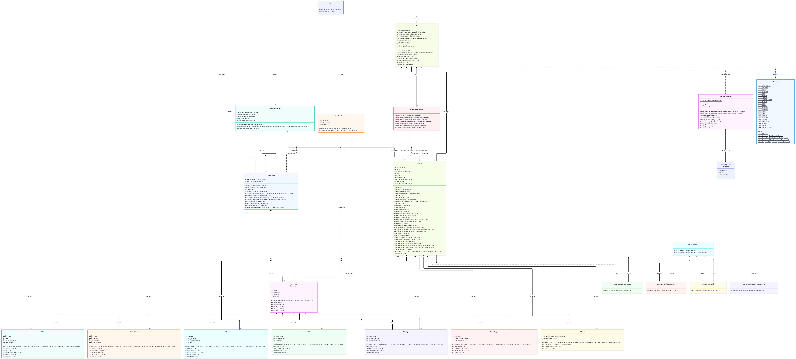
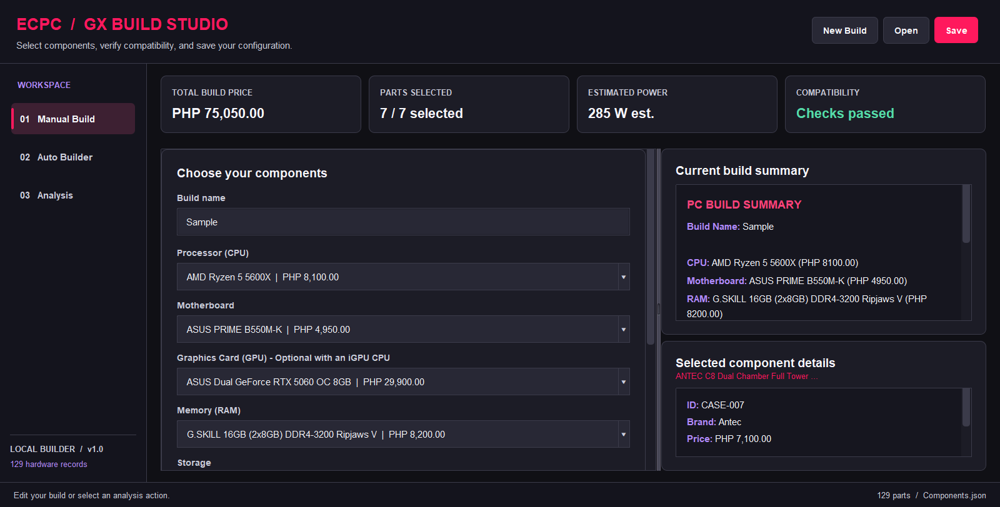
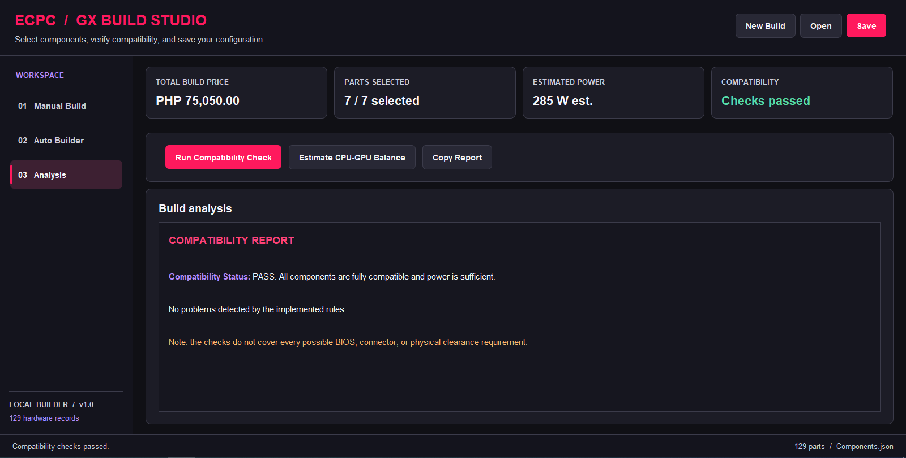
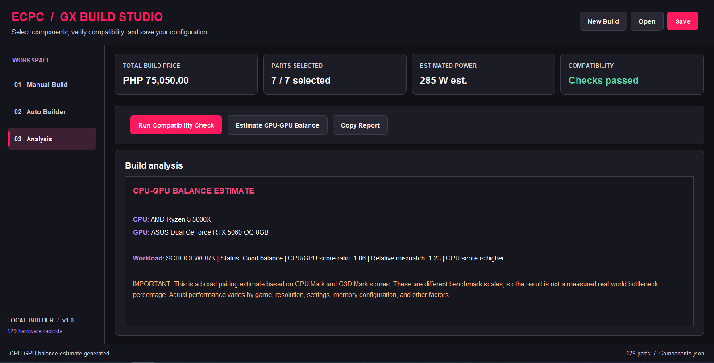
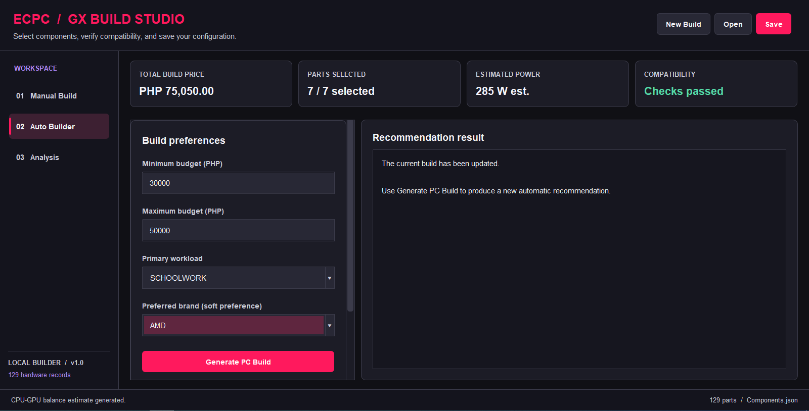
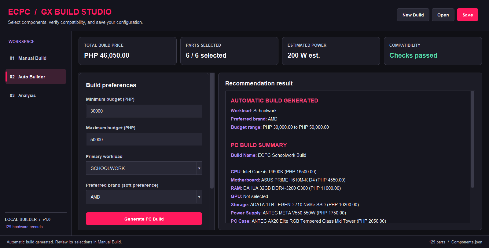

<p align="center">
  
</p>

<div align="center">

# 🖥️ ECPC: Efficient Custom Personal Computer Builder

**Batangas State University — The National Engineering University**  
*College of Informatics and Computing Sciences | Computer Science Department*  
*OOP 101: Object-Oriented Programming (1st Semester, AY 2026-2027)*

[](https://www.oracle.com/java/)
[]()
[]()

</div>

---

## 📖 About the Project
Building a custom personal computer is a technical task that can be overwhelming for beginners. Choosing incompatible parts or mismanaging your budget leads to wasted time, money, and hardware performance bottlenecks. 

**ECPC (Efficient Custom Personal Computer Builder)** is a Java-based gui application designed to help students, first-time PC builders, and hobbyists plan, validate, and optimize custom PC builds based on budget, intended workload (schoolwork, gaming, or video editing), and brand preferences.

---

## 🎯 Problem Being Addressed
* **Hardware Incompatibility:** Manually verifying sockets, RAM types, power draws, and case clearances is error-prone.
* **Budget Misallocation:** Users often overspend on unbalanced components (e.g., pairing an expensive GPU with a weak CPU).
* **Technical Complexity:** Beginners lack intuitive guidance when navigating complex hardware specifications.

---

## 🚀 Project Objectives

### General Objective
To develop a Java-based application that guides users in designing a compatible PC build within their budget by validating component compatibility and power requirements, rating the CPU-GPU balance, and recommending parts tailored to the user's workload.

### Specific Objectives
1. **Parts Catalog:** Load CPUs, motherboards, GPUs, RAM, storage, power supplies, and cases from a local data file with specifications, performance scores, and prices.
2. **Compatibility Validation:** Check CPU-motherboard sockets, RAM types/capacities, case form factors vs. GPU lengths, and PSU wattage safety margins.
3. **Auto-Build:** Automatically recommend a complete, compatible build within a specified minimum and maximum budget range.
4. **Bottleneck Detector:** Rate CPU-GPU balance as *Balanced*, *Moderate*, or *Severe* for the chosen workload.
5. **Custom Builds:** Allow users to create, edit, save, and load custom PC builds.
6. **Application of Object-Oriented Programming Principles:** Demonstrate core Object-Oriented Programming principles to ensure extensibility for new component types.

---

## 👥 Target Users

| Target User | How They Will Use the System |
| :--- | :--- |
| **Students** | Enter a budget range and school/light-gaming workload to receive affordable, compatible part recommendations. |
| **First-Time PC Buyers** | Input preferences to generate optimized builds while receiving warnings against incompatibilities or performance mismatches. |
| **PC Hobbyists** | Input custom part lists through the Custom Build feature to check compatibility, power draw, and bottlenecks before saving. |

---

## ✨ Main Features

* 🔍 **Compatibility Checker:** Verifies socket types, dimensions, form factors, and power sufficiency.
* ⚖️ **Bottleneck Detector:** Compares CPU and GPU performance relative to the chosen workload to flag potential performance bottlenecks.
* ⚙️ **Auto Build and Budget Optimizer:** Generates optimal builds matching user budgets and brand preferences.
* 🛠️ **Custom Build:** Lets users add, replace, or remove specific parts for a build they have in mind, with the running total cost and compatibility status shown as they edit.
* 💾 **Save & Load Builds:** Persist and retrieve your custom configurations from local files.

---

## 🛠️ Technologies Used
* **Programming Language:** Java
* **GUI Framework:** Java Swing
* **Data Format:** JSON (for storing PC component information)
* **Development Environment:** Visual Studio Code (VS Code)
* **Version Control:** Git and GitHub
* **Java Development Kit (JDK):** JDK 21
* **Compilation Tool:** Java Compiler (javac)
* **Application Packaging Tool:** Java Archive Tool (jar)
* **Application Distribution Format:** Executable JAR (.jar)
* **File Handling:** Java I/O and NIO (for saving and loading custom PC builds)

---

## 🧱 OOP Concepts Demonstrated

<table>
  <thead>
    <tr>
      <th>Principle</th>
      <th>Description</th>
    </tr>
  </thead>
  <tbody>
    <tr>
      <td><strong>Classes and Objects</strong></td>
      <td>Defines blueprints for hardware and system logic (such as <code>Component</code>, <code>CPU</code>, <code>Motherboard</code>, <code>GPU</code>, <code>RAM</code>, <code>Storage</code>, <code>PowerSupply</code>, <code>PCCase</code>, <code>PCBuild</code>, and <code>PartCatalog</code>), with objects representing individual catalog parts, the user's current build, and generated reports.</td>
    </tr>
    <tr>
      <td><strong>Methods</strong></td>
      <td>Encapsulates core operations including calculating total costs and estimated wattage (<code>PCBuild</code>), running compatibility checks (<code>CompatibilityChecker</code>), computing CPU-GPU balance (<code>BottleneckAnalyzer</code>), and generating recommended builds (<code>BuildRecommender</code>).</td>
    </tr>
    <tr>
      <td><strong>Encapsulation</strong></td>
      <td>
        Keeps attributes like price, socket type, wattage, dimensions, and performance scores private and accessed via public getters, while catalog parts have no setters to prevent modification after loading and build updates pass through validating methods like <code>addComponent()</code>.<br><br>
        <details>
          <summary><kbd>View Sample Code</kbd></summary>
          <table>
            <tbody>
              <tr>
                <td>
<pre lang="java">
public abstract class Component {
    private final String id;
    private final String name;
    private final String brand;
    private final double price;
    public String getId() { return id; }
    public String getName() { return name; }
    public String getBrand() { return brand; }
    public double getPrice() { return price; }
}
</pre>
                </td>
              </tr>
            </tbody>
          </table>
        </details>
      </td>
    </tr>
    <tr>
      <td><strong>Inheritance</strong></td>
      <td>
        Uses the abstract class <code>Component</code> to hold shared attributes (<code>ID</code>, <code>name</code>, <code>brand</code>, <code>price</code>), which <code>CPU</code>, <code>Motherboard</code>, <code>GPU</code>, <code>RAM</code>, <code>Storage</code>, <code>PowerSupply</code>, and <code>PCCase</code> extend to add their own specifications and avoid repeated code.<br><br>
        <details>
          <summary><kbd>View Sample Code</kbd></summary>
          <table>
            <tbody>
              <tr>
                <td>
<pre lang="java">
public class CPU extends Component {
    private final String socket;
    private final int tdp;
    private final int performanceScore;
    private final boolean hasIGPU;
    public CPU(String id, String name, String brand, double price,
               String socket, int tdp, int performanceScore, boolean hasIGPU) {
        super(id, name, brand, price);
        this.socket = socket;
        this.tdp = tdp;
        this.performanceScore = performanceScore;
        this.hasIGPU = hasIGPU;
    }
}
</pre>
                </td>
              </tr>
            </tbody>
          </table>
        </details>
      </td>
    </tr>
    <tr>
      <td><strong>Polymorphism</strong></td>
      <td>
        Handles all parts uniformly as <code>Component</code> objects (such as storing them in a single list and displaying them in a single loop) while each subclass overrides <code>getSpecs()</code> with specialized behavior.<br><br>
        <details>
          <summary><kbd>View Sample Code</kbd></summary>
          <table>
            <tbody>
              <tr>
                <td>
<pre lang="java">
// CPU.java
@Override
public String getSpecs() {
    return "Socket: " + socket + " | TDP: " + tdp + "W | Score: " + performanceScore + " | Integrated Graphics: " + hasIGPU;
}
// GPU.java
@Override
public String getSpecs() {
    return "VRAM: " + vramGB + "GB | Power: " + powerWatts + "W | Score: " + performanceScore + " | Length: " + lengthMm + "mm";
}
</pre>
                </td>
              </tr>
            </tbody>
          </table>
        </details>
      </td>
    </tr>
    <tr>
      <td><strong>Abstraction</strong></td>
      <td>
        Relies on the abstract class <code>Component</code> to declare mandatory methods for every part, hiding complex calculations like wattage totals and bottleneck formulas behind simple method calls for the GUI.<br><br>
        <details>
          <summary><kbd>View Sample Code</kbd></summary>
          <table>
            <tbody>
              <tr>
                <td>
<pre lang="java">
public abstract class Component {
    public abstract String getSpecs();
}
</pre>
                </td>
              </tr>
            </tbody>
          </table>
        </details>
      </td>
    </tr>
    <tr>
      <td><strong>Exception Handling</strong></td>
      <td>Employs custom exceptions (such as <code>IncompatibleComponentException</code>, <code>BudgetExceededException</code>, and <code>InvalidInputException</code>) alongside try-catch blocks to handle invalid inputs, incompatible parts, unfeasible budgets, and missing or corrupted files without crashing the program.</td>
    </tr>
    <tr>
      <td><strong>Arrays/Data Handling</strong></td>
      <td>Utilizes <code>ArrayList</code> collections to store the parts catalog, the components in the active build, and the collection of saved builds.</td>
    </tr>
  </tbody>
</table>

---

## 📂 Project Structure

The project is organized into dedicated folders to keep the source code, resources, documentation, screenshots, and compiled application properly arranged.

<table>
  <tr>
    <td>
      <details>
        <summary><kbd>🔽 Full Directory Tree — Click to Expand / Minimize</kbd></summary>
        <br>
<pre>
📁 ECPC/
│
├── 📄 README.md
├── 📄 .gitignore
│
├── 📁 docs/
│   ├── 📄 Project-Proposal.pdf
<details><summary>&nbsp;&nbsp;└── <kbd>🖼️ UML-DIAGRAM.png — Click to Preview</kbd></summary>

</details>
├── 📁 release/
│   └── 📦 ECPC.jar
│
├── 📁 screenshots/
│   ├── 📁 auto-build/
│   │   ├── 🖼️ autobuildinputs.PNG
│   │   └── 🖼️ autobuildoutputs.PNG
│   │
│   └── 📁 manual-build/
│       ├── 🖼️ manualbuildinputs.PNG
│       ├── 🖼️ manualbuildcompatibilitycheck.PNG
│       └── 🖼️ manualbuildbottleneckanalyzer.PNG
│
├── 📁 src/
│   └── 📁 main/
│       │
│       ├── 📁 java/
│       │   └── 📁 ecpc/
│       │       │
│       │       ├── 📁 components/
│       │       │   ├── ☕ Component.java
│       │       │   ├── ☕ CPU.java
│       │       │   ├── ☕ GPU.java
│       │       │   ├── ☕ Motherboard.java
│       │       │   ├── ☕ PCCase.java
│       │       │   ├── ☕ PowerSupply.java
│       │       │   ├── ☕ RAM.java
│       │       │   └── ☕ Storage.java
│       │       │
│       │       ├── 📁 exceptions/
│       │       │   ├── ☕ ECPCException.java
│       │       │   ├── ☕ BudgetExceededException.java
│       │       │   ├── ☕ IncompatibleComponentException.java
│       │       │   ├── ☕ IncompleteBuildException.java
│       │       │   └── ☕ InvalidInputException.java
│       │       │
│       │       ├── 📁 features/
│       │       │   ├── ☕ BottleneckAnalyzer.java
│       │       │   ├── ☕ BuildFileManager.java
│       │       │   ├── ☕ BuildRecommender.java
│       │       │   ├── ☕ CompatibilityChecker.java
│       │       │   ├── ☕ PCBuild.java
│       │       │   ├── ☕ PartCatalog.java
│       │       │   └── ☕ Workload.java
│       │       │
│       │       ├── 📁 gui/
│       │       │   ├── ☕ ECPCTheme.java
│       │       │   └── ☕ MainFrame.java
│       │       │
│       │       └── ☕ Main.java
│       │
│       └── 📁 resources/
│           └── 🗃️ Components.json
│
└── 📁 static/
    └── 🖼️ logo.gif
</pre>
      </details>
    </td>
  </tr>
</table>

---

## 👷 Team Members & Roles

| Team Member | Role | Assigned Tasks |
| :--- | :--- | :--- |
| **Palma, Tristan P.** | Project Leader | Coordinates tasks, monitors deadlines, communicates with the instructor, and facilitates team meetings. |
| **Carandang, Sean Christ Trez' Davidoff A.** | Lead Programmer | Coordinates the implementation of Java classes, methods, and OOP features. |
| **Palor, Christian Gene C.** | System / Design Lead | Develops system requirements, class designs, UML diagrams, and overall application structure. |

---

## 💻 Instructions for Running the Program

<table>
  <tr>
    <td>
      <details>
        <summary><kbd>🔽 Getting Started — Click to Expand / Minimize</kbd></summary>
        <br>

## Getting Started

Follow the instructions below to download and run ECPC on your computer.

### 1. System Requirements

- **Operating System:** Windows, macOS, or Linux
- **Java Runtime Environment:** Java 17 or later
- No external database or additional libraries required.
- No IDE or Java Development Kit (JDK) is required to run the application.

### 2. Install Java (If Not Installed)

Download and install the Java Runtime Environment (JRE) from Eclipse Adoptium.

| Java Version | Download Link |
| --- | --- |
| Java 17 (LTS) | [Download Java 17](https://adoptium.net/temurin/releases/?version=17) |
| Java 21 (LTS) | [Download Java 21](https://adoptium.net/temurin/releases?version=21) |

#### Installation Instructions

1. Open either of the download links above.
2. Select your operating system (Windows, macOS, or Linux).
3. Select your system architecture (`x64` for most Windows computers).
4. Select **JRE** as the package type.
5. Download the appropriate installer or package.
6. Complete the installation.
7. On Windows, enable the option to add Java to the system `PATH` if available.

For additional installation instructions, refer to the [Official Java Installation Guide](https://adoptium.net/installation).

After installation, reopen Command Prompt or Terminal and verify the installation:

```bash
java -version
```

> [!NOTE]
> You only need the Java Runtime Environment (JRE) to run ECPC. The Java Development Kit (JDK) is only necessary if you intend to compile or modify the source code.

### 3. Download ECPC

1. Navigate to the **Releases** section of this GitHub repository.
2. Select the latest stable release.
3. Locate the **Assets** section.
4. Download `ECPC.jar`.
5. Save the file to your preferred directory.

### 4. Run the Application

#### Double-Click

If your operating system has Java configured to open JAR files, simply double-click `ECPC.jar` to launch the application.

#### Terminal / Command Prompt

Alternatively, open your terminal or Command Prompt inside the folder where you saved `ECPC.jar` and run:

```bash
java -jar ECPC.jar
```

</details>
</td>
</tr>
</table>

---

## 📸 Sample Screenshots

The following screenshots showcase selected features and functionalities of the ECPC application.

### Manual Build

#### 1. Component Selection
Allows users to manually select PC components for their custom build.



#### 2. Compatibility Check
Displays the compatibility results of the selected PC components.



#### 3. Bottleneck Analysis
Presents the CPU-GPU balance analysis based on the selected workload.



---

### Automatic Build

#### 1. User Inputs
Allows users to specify their budget, intended workload, and brand preferences.



#### 2. Generated Build
Displays the recommended PC components based on the user's selected preferences and budget.



---

## ⚠️ Known Limitations
* **No Live Pricing:** Prices and specifications are derived from a static local dataset.
* **Estimated Benchmarks:** Performance scores and bottleneck ratings rely on fixed reference scores rather than real-time hardware diagnostics.
* **Standard Desktop Parts Only:** Specialized server hardware, laptops, pre-builts, custom liquid cooling loops, and individual CPU coolers/case fans are excluded.
* **Local Storage Only:** No user accounts or cloud storage features; all saved builds reside in local files.

---

## 🔮 Future Improvements
Although ECPC already provides essential PC building and recommendation functionalities, several improvements can be considered for future versions:

* **Expanded Component Database:** Include more PC components, brands, models, and updated hardware specifications to provide users with a wider range of choices.
* **More Accurate Bottleneck Analysis:** Improve the analysis algorithm by incorporating more realistic performance data, workload-specific calculations, and benchmark information.
* **Advanced Compatibility Checking:** Expand compatibility validation to cover additional hardware specifications and requirements, ensuring more accurate component recommendations.
* **Improved Build Recommendations:** Enhance the recommendation algorithm to consider more factors, such as component performance, price-to-performance ratio, upgrade potential, and user preferences.
* **Price Updates and Comparison:** Introduce updated component pricing and price comparisons from different retailers to help users make more cost-effective decisions.
* **Build Exporting and Sharing:** Allow users to export their PC configurations into formats such as PDF or share their builds with other users.
* **Enhanced User Interface:** Further improve the graphical interface with additional customization options, better navigation, and a more user-friendly experience.
* **User Accounts and Build History:** Introduce user accounts that allow users to save multiple PC configurations and access their previous builds.

---

## 🗂️ Project Contributors & Repository
* **Team Name:** An Family (Section: CS 2101)
* **GitHub Repository:** [ECPC-Efficient-Custom-Personal-Computer-Builder](https://github.com/AN-FAMILY-OOP101/ECPC-Efficient-Custom-Personal-Computer-Builder.git)

---

<div align="center">
  
</div>

